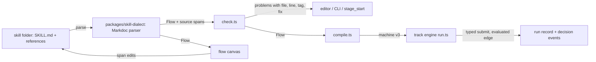

# Skills and Flows with Enforced Logic, Written in Markdown and Edited from the Flow Editor

*   **Author:** nesyeklaf
*   **Status:** Draft
*   **Date:** 2026-11-04

--------------------------------------------------------------------------------

## Overview

Skills and flows get one written form: a skill folder whose Markdown carries Markdoc tags for stages, typed inputs and outputs, gates and transitions. One TypeScript parser and validator reads these files. The flow canvas draws them, and the track compiler turns them into the machine the track engine enforces. The flow editor becomes the place where skills are created and edited as a whole: the SKILL.md body, reference files, and the flow inside a skill. The folders stay valid Agent Skills folders. Claude Code, Codex and other agents read the tags as instructions and enforce nothing.

The work ships in stages. Stage 1 is an experiment on one small chain, `think-it-through` (frame-the-problem → weigh-options → premortem → review, with a loop back to weigh). It proves or disproves the central claim before anything else is built on it: that a Markdown file can drive an enforced branch on a typed value. Later stages extend the same contract to full-control and full-send, the stored flows, folder editing and composition across skills.

## The Problem

A skill is supposed to change something, in the owner's head or in the world, and to get there along a thread of cause and effect. Today that thread is not enforced for most skills, and it cannot be authored where the owner works.

*   **Logic lives in prose.** 108 of the 110 installed skills (`ls ~/.agents/skills`, 2026-11-04) have no `stages.json` and describe their procedure only as text, for example the egm-* skills in `references/procedure.md`. The model reads it and may skip a step, take the wrong branch or loop forever. Nothing checks it.
*   **Enforcement lives in JSON beside the skill.** Only full-control and full-send ship a `stages.json`. It is a second description of the same procedure, in a format the owner rejects for authoring, and it drifts from the prose.
*   **Branches are not evaluated.** Even with `stages.json`, the engine never evaluates `next[].when`. It is free text, and `pickEdge` takes whatever destination the model names. Outputs are untyped strings, so there is nothing a condition could test.
*   **Authoring is split.** Flows are built on the canvas and stored as JSON in the plugin's key-value store. Skills are edited in a separate editor that writes only SKILL.md. Reference files and the flow inside a skill cannot be edited at all. Writing a new skill with a real procedure means hand-editing several files in several formats.

The result: the two enforced skills are enforced through a format the owner does not want to write, and a new skill with a procedure has no way to become enforced. Not every skill needs enforcement; the goal is that a skill which needs it can get it in Markdown.

## Goals

1.  **One written form.** A skill's or flow's procedure is written once, in Markdown with Markdoc tags. No JSON, YAML or TOML as an authoring format. The Agent Skills YAML frontmatter stays, because the standard requires it.
2.  **Declarative logic, enforced in Sandy.** Stages, gates, typed outputs and transitions are binding in a Sandy track. A branch with a condition is chosen by evaluating it on a typed value, not by the model naming a destination; only the owner can override, and every override is logged as such. No user code runs.
3.  **Binding and non-binding text are visibly different.** Control flow has its own tag (`next`). Conditional text (`if`) only changes what the model reads. A reader can tell which lines the engine enforces.
4.  **One parser, located errors.** The canvas, `stage_start` and a CLI check use the same parser, validator and compiler. Every error names file, line, tag and a suggested fix.
5.  **Portable folders.** A skill folder passes the Agent Skills validator and stays usable as plain instructions in Claude Code and Codex. Whether those agents follow the logic is tested and recorded, not assumed.
6.  **The flow editor edits whole skills.** Create a skill, edit its SKILL.md body, its reference files and the flow inside it from the flow editor.
7.  **No enforcement lost in migration.** full-control and full-send, and the flows stored today, move to the new form without any host running an enforced skill unenforced.
8.  **Stage 1 answers the central question.** The think-it-through experiment meets all five checks in [experiment.md](/home/aemon/.sandy-machines/aemonke.getbb.app/plugins/environment-git-worktree/host-data/worktrees/thr_2awpg9fnrd-1/sandy/.work/egm/skill-authoring-in-flow-editor/experiment.md): the five checks are stated there and only there.

## Non-Goals

*   **A programming language.** No arbitrary code, no general expressions, no user-defined functions. Conditions call only functions Sandy registers. The existing `check` gates and `autopilot` remain the only places code runs, and they are labelled as such.
*   **Enforcement outside Sandy and pi.** Other agents get instructions, not guarantees. Sandy says so where it shows a skill.
*   **Visual editing of arbitrary Markdoc.** The canvas edits the constructs the flow graph knows. Anything else is source-only and survives saves untouched.
*   **Rewriting the prose of existing skills.** Converting a skill adds tags; it does not reword it.
*   **In stage 1:** composition of staged skills inside one another, writes to reference files or new folders, migration of the stored flows, and conversion of full-control and full-send. These belong to later stages.

## Open Questions

*   **Checker cost**: one extra agent run per review visit. Measured in S8; no decision depends on it before then.

## Glossary

*   **Skill**: an Agent Skills folder (SKILL.md plus optional files).
*   **Flow**: a skill whose SKILL.md carries dialect stages; it may call other skills as stages.
*   **Stage**: one `stage` tag; compiled to one stage of a track machine.
*   **Track, run, lease**: the track engine's machine, one execution of it in a thread, and the right to work one stage visit.
*   **Checker**: a delegate with a fresh context that drives a judging stage (D1).
*   **Content hash**: SHA-256 of the SKILL.md bytes.

## Critical User Journeys (CUJs)

### CUJ 1: A branch is enforced, not followed by goodwill (stage 1)

*   **Given**: think-it-through is installed as a skill folder and shown in Flows with inputs Task and Choice and outputs Pick and Premortem. The task carries a planted fault: both offered options break a must criterion.
*   **When**: the owner starts it as a track. The checker in the review stage first submits a `Checks` entry `nope`, then marks the must "costs nothing" as `broken`, and on the second pass all musts as `met`.
*   **Then**: `nope` is refused at submit. The engine derives `fix`, which sends the run back to weigh. The second review passes and the run ends with Pick and Premortem. The track log shows each edge with the condition that chose it.

### CUJ 2: A broken file is caught before a run

*   **Given**: someone edits a skill outside Sandy and points a `next` at a stage that does not exist, or puts a condition on a text output.
*   **When**: the file is checked by the CLI, opened in the flow editor, or started as a track.
*   **Then**: each entry point reports the same error with file, line, tag and a fix. The skill shows as broken, not missing.

### CUJ 3: The owner writes a new skill with a procedure, without leaving the flow editor (later stage)

*   **Given**: the owner wants a new skill whose procedure has a review that loops back.
*   **When**: they create it in the flow editor, draw its stages and forks, write the body text of each stage and a reference file.
*   **Then**: Sandy writes a valid skill folder. The skill runs enforced in Sandy and reads as instructions in Claude Code.

### CUJ 4: The same folder in another agent

*   **Given**: a converted skill folder.
*   **When**: it is loaded in Claude Code or Codex.
*   **Then**: it passes the Agent Skills validator. The agent sees each step and each branch labelled in plain words with its destination. Whether it follows them is recorded.

## Technical Plan (Architecture)

### Shape

One contract sits in the middle: the track machine in `extensions/sandy/work/track/machine.ts`. Markdown and canvas are adapters to the existing flow model; the engine stays the only enforcer. There is one graph model (`Flow` in `skill-usecases/graph.ts`), one validator (`check.ts`) and one compiler (`compile.ts`). The Markdown parser is one more adapter that emits `Flow`.

### Components

1.  **Dialect (`metadata.dialect: "1"`).** Markdoc (`@markdoc/markdoc`, approved by the owner on 2026-11-04) with a closed tag set: `input`, `stage`, `output`, `derive` with `case`, `next`, `gate`, `result`, and Markdoc's own `if`/`else` and variables. Unknown tags fail. `next`, `gate`, `output` and `derive` are only valid inside a `stage`; `if` only changes rendered text and can never contain `next`. Every `next` carries a plain-words `label`, which is what other agents read. `done` is reserved: `next to="done"` ends the run, and no stage may use that id (matches `DONE_STAGE` in `compile.ts`). Text renders when a lease is minted, with the run's inputs and the latest accepted outputs of other stages; a variable that is neither is a validator error at load. A reference to a stage that may not have run yet on this path (in the fixture, `$review.Checks` inside `weigh`) is allowed in conditions, where an absent value makes `equals`, `any` and `all` false and `present` false; a bare render of it is allowed only inside an `if` whose condition contains `present(...)` of that value. So an empty render cannot happen at runtime. Every value a stage's text or conditions reference is compiled into that stage's `inputs` (`stage.output`), which is what a driver without the conversation receives. The reference fixture is [think-it-through.md](/home/aemon/.sandy-machines/aemonke.getbb.app/plugins/environment-git-worktree/host-data/worktrees/thr_2awpg9fnrd-1/sandy/.work/egm/skill-authoring-in-flow-editor/think-it-through.md).
2.  **Parser (new workspace package `packages/skill-dialect`).** Input: the folder's files. Output: the existing `Flow` from `graph.ts`, extended by source spans per node, edge conditions as an AST, derived outputs, and `max`/`exceeded` on edges. `graph.ts`, `check.ts`, `compile.ts` and their dependency `io.ts` move into the same package so the track plugin and `skill-usecases` import one copy; plugins already depend on workspace packages (`@sandy/shared-ui`, `@sandy/async-cache`). The layout of an imported flow comes from the compiler's stage order (left to right); positions are not stored in Markdown.
3.  **Validator: `check.ts`.** It stays the only validator; its `Problem` codes gain a source span (file, line, tag) and keep their `fixes`. It runs in the editor on save, in `sandy skills check <path>`, in forge-skills CI and at `stage_start`.
4.  **IO authority: the frontmatter.** `metadata.inputs` / `metadata.outputs` of a flow declare only the flow's own inputs and its result. A stage with `skill=` gets that skill's declared outputs; an `output` tag in it must name one of them and repeat its type. A stage without `skill=` declares its outputs on its own `output` tags. Derived outputs come from `derive`. Every `output`, `result` and condition operand must resolve to one of these; `io.ts` parses the types (separator `;`).
5.  **Typed values in the engine.** `fieldSchema` gains a `type`: `text`, `url`, `file`, `choice(...)`, `list(T)`, `map(K, T)`. Values stay strings on every boundary (`Submissions`, CLI `--outputs`, `stage_submit`), so no contract changes:
    *   `list(T)`: one `1. item` line per entry, numbered from 1. An entry is one line; empty entries and duplicates (compared trimmed) are refused.
    *   `map(K, T)`: one `- n: value — reason` line per key, where `n` is the position of an entry in the list `K`. `K` is a qualified reference to an earlier list output (`$frame.Musts`), so two stages with an output of the same name cannot be confused, and no entry text is ever parsed as a key. Every position is required once; a missing, duplicate or extra position is refused, and a reason is required when the value is not the first choice. The value is a `choice`, so it cannot contain the `—` separator; the reason is the rest of the line.
    *   `submit` in `run.ts` refuses a value outside a `choice`, a missing or extra map key, and any submitted derived output, and names what is allowed. An empty list output is refused at its own submit.
    *   Display renders lists and maps as Markdown lists, a map with each entry's text from `K` next to its position.
6.  **Evaluated edges.** `next[].when` becomes a parsed condition: `equals($stage.Output, "value")`, `present($stage.Output)`, `any($stage.Map, "value")`, `all(...)`, `not(...)`, `and(...)`, `or(...)`. These are the only registered functions in dialect 1; they are pure. `compile.ts` keeps the structured condition on the edge instead of turning it into prose (`forkWhen` today). Derived outputs are computed at `stage_advance`, after the outputs gate, then `pickEdge` evaluates conditions in order and takes the first true one; an edge without `when` is the fallback. An explicit `to` from the model is accepted only if it equals the evaluated edge, and an agent's `stage_propose_force` on a stage with evaluated edges is refused. The owner's force stays and is logged as an owner override. An edge without a condition stays model-chosen as today, with its `label` as the stated reason. Branch logic is enforced in `run.ts`; the pi guard keeps enforcing tools only, because `policyFor` (`run.ts`) writes only stage ids, `next` ids, `allow` and `driver`.
7.  **Visit limits.** `next` takes `max=<n>` and `exceeded="owner"`. The limit counts traversals of that edge, not visits of the stage: a review visit that takes `owner` or `done` does not use up a `fix` round. When the edge would be taken for the (n+1)th time, the run stops at an owner form showing the last outputs of the stage, with three choices: accept (take the fallback edge), one more round (take the edge, that edge's counter back to 1), abort.
8.  **Machine and run v3.** The compiled machine carries `version: 3` and the content hash, dialect and compiler version. `Run.version` becomes 3 and gains `visits: Record<stageId, number>`, `edgeCounts: Record<"<from>><to>", number>` (incremented in `pickEdge` when the edge is taken, persisted with the run so a restart keeps it) and `decisions` (see S2). A v3 machine needs no `HOST_DAEMON_PROTOCOL_VERSION` bump: the policy goes through the plugin host RPC `writePolicy`, not a daemon command.
9.  **Canvas.** The Flows view draws `Flow` as today. Stage 1: read-only import of skill-folder flows next to the stored KV flows. Later: span-based edits write back to the file; untouched bytes stay identical.

### Decisions

*   **D1 – conditions on judgment. Decided: decompose, derive, check independently.**
    *   A judgment is split into one typed verdict per criterion. In think-it-through, frame outputs the must criteria as a list (`Musts: list(text)`), and review submits `Checks: map($frame.Musts, choice(met, broken, unclear))` with a reason per entry.
    *   The branch value is derived by the engine, never submitted: `Verdict = fix if any(Checks, "broken")`, `owner if any(Checks, "unclear")`, else `pass`. Dialect 1 adds the pure functions `any` and `all` and the types `list` and `map`.
    *   The judging stage runs on its own driver: a checker with a fresh context from another model family than the lease that produced the pick (Claude author → Sol, any other author → Opus). If that family is unavailable, the same family with a fresh context runs and the run log records it. Per-stage drivers exist today for autopilots; a checker delegate as driver is new engine work (S3).
*   The owner may switch a checker stage to the agent; the switch is logged as an owner override.
    *   A fact that a command can check (tests, build, reachable URL) uses the existing `check` gate, not a judgment.
    *   `unclear` stops at a user gate for the owner.
    *   Limit: the engine enforces that every criterion is judged by someone other than the author, not that the judgment is right.
*   **D2 – composition across skills. Decided: compile-time inlining with namespaced ids.**
    *   A flow node that calls a staged skill is replaced at compile time by that skill's stages, ids prefixed with the node id (`frame/clarify`). The skill's `input` tags bind to the node's wires; its `result` tags become the node's outputs.
    *   Stage budget: the compiler counts stages across the whole flow and fails with a located error above the engine limit of 40. Inlining is one level deep in dialect 1; a staged skill that itself inlines another is rejected.
    *   The flow pins each inlined skill by content hash. When the installed skill differs, the validator reports drift and the flow runs the pinned copy only after the owner re-pins.
    *   Per-stage `allow` of the inlined skill is kept; a flow-level `allow` applies only to stages without their own.
    *   Not covered: tracks inside tracks, separate cancellation of a called skill, recursion.
*   **D3 – where flows live. Decided: both levels.**
    *   A new flow is written to the project: `<repo>/.sandy/skills/<flow>/SKILL.md`, the existing `sandy-project` root in `list-skills.ts`. It is committed with the project.
    *   The owner can promote a flow to the user level, `~/.agents/skills/<flow>/`, whose source is forge-skills. Promotion is an explicit action, never automatic, and warns that forge-skills is public.
    *   On a name clash the project flow wins. Flows and the canvas show the origin (project or user) and the shadowed copy.
    *   A project flow that contains a `check` gate or a `run` step needs the owner's approval on its first start, pinned by content hash like an ad-hoc track; a changed hash asks again. The start prompt names both origins when a project flow shadows a user skill.
*   Stored KV flows migrate in stage 3. The owner picks the target (a project or the user level) per flow, with a preview; an unassigned flow stays read-only in KV.

### Stages

| Stage | Contents | Proves |
| --- | --- | --- |
| 1 | Dialect 1, parser/validator, typed outputs incl. list/map, derived verdicts, checker driver for review, evaluated edges, visit limit, machine v3, read-only import of think-it-through | A Markdown file drives an enforced branch on a typed value |
| 2 | full-control and full-send in the dialect; a recorded run replays to the same stage sequence and gates on both machines; `stages.json` generated for older hosts | No enforcement lost. Done when both run from SKILL.md and their `stages.json` are deleted (owner, 2026-11-04) |
| 3 | Canvas writes back by span; conflict-checked saves through `experimental_write` with `revision`; guard covers logic-bearing files; KV flows migrated (D3) | Editing in the flow editor |
| 4 | Folder and reference-file writes (`experimental_write` and `host.write_skill` extended to paths inside the skill folder, protocol bump); composition (D2); `stages.json` retired | Whole skills authored in the flow editor |

## Alternatives Considered

| Alternative | For | Against | Outcome |
| --- | --- | --- | --- |
| **Status quo:** prose procedures, `stages.json` for the two enforced skills | No work; the engine already runs it | Logic stays unenforced in 108 skills; JSON beside the prose drifts; `when` is never evaluated | Rejected: it is the problem |
| **Keep `stages.json`, only fix the engine** (typed outputs, evaluated `when`) | Smallest change to enforcement | Authoring stays in JSON, which the owner rejects; the second description of the procedure remains | Rejected; the engine part is kept (Technical Plan 4–7) |
| **MDX** | Familiar; components | Its only extra over Markdoc is executable code, which is a non-goal; a bare `{`, `<` or HTML comment in prose breaks the parser | Rejected |
| **An own format** (OCaml, BAML, Pkl, CUE, a TypeScript DSL) exported to a skill folder, possibly with two-way sync | Strong typing; full control of the grammar | Two sources of truth; a toolchain on every host; hard for models to write; the folder is no longer what people edit | Rejected: one-way compile from Markdown keeps one source |
| **remark + remark-directive** (already in `apps/app`) | No new dependency; `:::stage{id=...}` containers with position spans | No variables and no conditional rendering, which the owner requires (render by input); a second, own layer would be needed for `if` | Rejected. Fallback if Markdoc has to go: the same tags on remark-directive plus an own `if` |
| **JSON, YAML or TOML sidecar** next to SKILL.md | Easy to parse | Ruled out by the owner; again a second description | Rejected |
| **Logic in `references/flow.md`**, SKILL.md stays prose | Short body; lower token cost for other agents | Stages are resolved across files; the body and the flow can disagree | Deferred: dialect 1 keeps stages in SKILL.md; revisited with the token measurement in S0 |
| **D1 A:** the model submits the verdict as a `choice` | Simple | The author of the pick approves itself with the convenient value | Rejected for D1 (decompose, derive, check independently) |
| **D1 B:** edges marked `judged`, chosen by the model | Matches how full-control branches today | Enforcement erodes as authors reach for it | Rejected |
| **D1 C:** the owner picks the branch at a user gate | The owner's judgment is authoritative | Runs stall without the owner | Kept only as the `unclear` fallback inside D1 |
| **D2 sub-track:** a called skill runs as its own track | Clean scoping, cancellation, no stage cap | Nested runs, permission composition and recursion are new engine capabilities | Rejected for now; revisit if a flow exceeds the stage budget |
| **D2 flat:** a staged skill is one stage in a flow | Nothing new | The called skill's gates are not enforced inside the flow | Rejected; it remains how unstaged skills run |
| **D3 user level only** (`~/.agents/skills`) | One place | Private and project flows land in a public repo | Rejected for D3 (both levels) |
| **D3 project only** (`.sandy/skills`) | Matches the existing project root | The same flow is copied between projects | Rejected for D3 (both levels) |
| **Flows stay in the plugin KV store** | Works today | No project scope; last writer wins; not readable outside Sandy | Rejected; migrated in stage 3 |

## Detailed Implementation

### Stage 1: the think-it-through experiment

Slices ship in this order. The engine slices deploy before anything emits a v3 machine. Files: C = create, M = modify, D = delete.

| # | Slice | Files | Test that shows it works |
| --- | --- | --- | --- |
| S0 | **Measure and verify assumptions**, before any engine change. Parse every installed skill with Markdoc, following symlinks; count files containing `{%`. Round-trip parse → serialize over all of them. Measure raw versus rendered tokens on think-it-through and two converted skills. Run a hand-written think-it-through in Claude Code and Codex and record whether the steps are followed. | C scratch scripts in `/tmp/` | A short report in the artifact directory with the numbers. Stop if the parse or round-trip shows diffs the dialect cannot avoid, or if rendered tokens exceed raw tokens by more than 50% (the estimate in [experiment.md](/home/aemon/.sandy-machines/aemonke.getbb.app/plugins/environment-git-worktree/host-data/worktrees/thr_2awpg9fnrd-1/sandy/.work/egm/skill-authoring-in-flow-editor/experiment.md)'s brief). |
| S1a | **Compatibility release.** A stored run with an unknown `version` is kept, not dropped: the guard stays locked, the thread is told "this track needs a newer sandy", and no new track starts in that thread. | M `extensions/sandy/work/track/server.ts` (startup scan, `load`), M `run.ts` (`policyFor`) | `server.test.ts`: a stored v3 run on this loader keeps a locked policy and refuses `stage_start`. |
| S1 | **Typed values and evaluated edges** per Components 5–8: `fieldSchema.type` incl. `list`/`map`, string encodings, derived outputs, parsed conditions, `next.max` + `exceeded`, `version: 3`, `visits`, `edgeCounts`, absent-value semantics, references compiled into `stage.inputs`. `pickEdge` evaluates instead of trusting `to`; agent force on evaluated stages refused. IO types also in the skill tooling. | M `extensions/sandy/work/track/machine.ts`, M `run.ts`, M `extensions/sandy/skill-usecases/io.ts` (`parseType`, `satisfies`), M `graph.ts` (port types) | `machine.test.ts`: first true edge wins, fallback edge, a disagreeing `to` is refused, `max` exceeded opens the owner form with its three choices; fix, owner, fix interleaved counts two `fix` traversals; counts survive a restart; "one more round" resets only that edge. `run.test.ts`: `Checks` entry `nope` refused with the allowed values; missing, duplicate and extra positions refused, a duplicate or empty `Musts` entry refused, a must containing `:` round-trips; a submitted `Verdict` refused; a v2 run still loads; agent `proposeForce` on an evaluated stage refused, owner force logged. `io.test.ts`: `list(text)` and `map(Musts, choice(...))` parse and `satisfies` works. |
| S2 | **Decision events.** Each evaluated edge records visit, edge, condition span, operand values and outcome in `Run.decisions`, capped at `LOG_LIMIT` (oldest dropped and counted like `logDropped`); operand values clipped at 2 000 characters; all of it counts against `MAX_RUN_BYTES`, and a submit that would exceed it is refused as today. Shown in `stage_status` and the track log. | M `run.ts`, M `server.ts` | `run.test.ts`: the event carries the condition and the values that chose the edge; the cap drops the oldest; an oversized submit is refused. |
| S3 | **Checker driver.** `Driver` gains `{ kind: "checker", agent, model }`. New effect `spawn-checker`: the server starts a delegate whose brief holds the ticket. The child claims like an autopilot (invocation → grant) and submits with `sandy work track drive submit --thread <parent> --grant <grant>`; `holder()` accepts `by: "driver"` for autopilot and checker. A lost child: the claim expires like an autopilot heartbeat and the effect relaunches; a failed child releases the stage to the owner, never to the author. The pi extension accepts the new driver kind. | M `run.ts` (`Driver`, `driverFor`, `holder`, effects), M `effects.ts`, M `server.ts`, M `contract.ts` (`driverSchema`), M `policy.ts`, M `app.tsx` (`DriverPicker`) | `run.test.ts`: the author's lease on a checker stage is refused; stolen ticket, double submit, restart, child failure and cancel each end as specified; owner `setDriver` to agent is logged as override. An old pi extension reads the new policy without failing. The child's brief contains Musts, Pick and Premortem as stage inputs although its thread has no parent history. One live run: the review lease runs in a separate child thread. |
| S4 | **Shared package and parser.** Create `packages/skill-dialect`; move `graph.ts`, `check.ts`, `compile.ts` and `io.ts` into it unchanged, then add the Markdoc parser that emits `Flow`, source spans on `Problem`, the condition AST, `derive`/`case` and the reserved `done`. First check: both plugins build with the package through `plugin-build`. | C `packages/skill-dialect/`, M `extensions/sandy/skill-usecases/{graph,check,compile,io}.ts` (moved, re-exported), M both plugins' `package.json` | Fixture tests: think-it-through compiles to a checked-in machine fixture; the first render of `weigh` has no review paragraph, the render after a `fix` has it; three broken copies (unknown `to`, `when` on a text output, an `output` the called skill does not declare) each give file, line, code and fix. Every installed skill without `metadata.dialect` parses with zero errors. |
| S5 | **Template loading and CLI.** `loadTemplate` reads SKILL.md when `metadata.dialect` is set and sorts matches project first; a `stages.json` next to dialect stages is a generated sidecar when a file `stages.generated` next to it holds the SKILL.md content hash: new loaders ignore it and use SKILL.md. Without that file or with a stale hash it is a conflict error. The marker is a separate file because `machineSchema` is `.strict()` and the shipped loader would refuse an extra field. `sandy work track validate` accepts SKILL.md. New plugin command `sandy skills check <path>`, documented in the skill-usecases plugin SKILL.md. Update the track instruction strings that name `stages.json` (`work/track/server.ts`). | M `extensions/sandy/work/track/server.ts`, M `extensions/sandy/skill-usecases/server.ts`, M skill-usecases `SKILL.md` | `server.test.ts`: `stage_start({skill:"think-it-through"})` starts a v3 run; the conflict case errors, a matching sidecar is ignored, and the shipped loader starts the generated `stages.json` unchanged; a project copy wins over a user copy; a project flow with a `check` gate asks for approval once per content hash. The CLI prints the S4 errors on the broken copies. |
| S6 | **Read-only import into Flows.** Skill folders with dialect stages show in Flows next to KV flows, with origin, inputs, outputs and the canvas drawn from `Flow`. No editing. | M `extensions/sandy/skill-usecases/server.ts`, M `flows.tsx` | Browser check: think-it-through shows inputs Task, Choice, outputs Pick, Premortem, 6 stages plus done, 3 forks. |
| S7 | **Skills for the chain.** frame-the-problem declares `Frame: text`, `Clear: choice(yes, no)` and `Musts: list(text)`; every other called skill declares the outputs the fixture names. think-it-through lands at `<repo>/.sandy/skills/think-it-through/` per D3. Depends on S1 being deployed. | M forge-skills `skills/*/SKILL.md` (PR), C `.sandy/skills/think-it-through/SKILL.md` | `sandy skills check` passes; the Agent Skills validator passes. |
| S8 | **The run.** The planted-fault input; record the five checks of experiment.md and the checker cost. Load the same folder in Claude Code or Codex and record whether the steps are followed. | none | Run log and decision events: one fix → pass loop, `nope` refused, edges from evaluated conditions. |

**Done when:** S8 meets all five checks. If the checker passes the broken pick, or a branch is taken without an evaluated condition, the experiment has failed, and stage 2 does not start until the cause is known.

### Stages 2 to 4

*   **Stage 2 – full-control and full-send.** Map every `machineSchema` field to a tag (`allow`, `autopilot`, `check`, `evidence`, `goal`, per-edge gates, `start`). Their `when` values are free-text judgments (6 in full-control, 3 in full-send); they become `next` labels without a condition and stay model-chosen. Verification is behavioural: a recorded run of each skill replays to the same stage sequence and the same gates on the JSON machine and on the Markdown machine. Generate `stages.json` plus its `stages.generated` hash file for hosts without v3 until all hosts run it (S5 defines the sidecar rule). Done when both run from SKILL.md and their `stages.json` are deleted.
*   **Stage 3 – editing in the flow editor.** Span-based writes from the canvas, byte-identical for untouched text (round-trip test over all installed skills); conflict-checked saves through `sandy.sdk.skills.experimental_write` with `revision` (daemon `host.write_skill`, `writeHostFile` with `expectedSha256`); validated/activated states with last-known-good; the guard protects the running skill's folder; KV flow migration per D3.
*   **Stage 4 – whole skills.** Extend `experimental_read`/`experimental_write` and `host.write_skill` (`rootPath` confinement, `createParents`) to reference paths inside the skill folder, with `api_to_audit.md` updates, a `HOST_DAEMON_PROTOCOL_VERSION` bump, size and file-count limits; the editor disables reference edits on old daemons with the reason; inlining per D2; promotion per D3; `stages.json` retired with every surface keyed on it updated in the same release.

### Rollout and rollback

*   S1a deploys first, then S1–S3. Rollback is allowed down to S1a, never below it: S1a keeps a v3 run locked instead of dropping it, so no run continues unenforced. The shipped loader before S1a drops unknown versions silently (`server.ts` startup scan and `load`).
*   Each stage is its own PR in the sandy repo; forge-skills changes are separate PRs the owner merges.
*   Deploys go through `scripts/fork/deploy.sh` per FORK.md.
