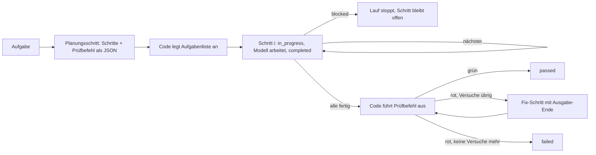

# Autopilot: Handbuch

Teil 1 ist für Leute, die entscheiden, ob wir es einsetzen. Teil 2 ist für Leute, die es benutzen oder ein eigenes schreiben.
Die Messdaten stehen im Anhang.

## Teil 1: Auf einer Seite

**Kurz gesagt:** Beim Autopilot steuert ein Programm den KI-Agenten, statt dass der Agent sich selbst steuert. Das Programm
legt die Schritte fest, führt die Aufgabenliste, startet die Tests und entscheidet, ob nachgebessert wird. Das Modell
erledigt nur die einzelnen Arbeitsschritte. Ein günstiges Modell liefert damit eine mittelgroße Aufgabe so zuverlässig ab
wie sonst nur ein teures. Der Nutzer sieht jederzeit, woran gerade gearbeitet wird. Ein abgebrochener Lauf lässt sich
fortsetzen.

**Was ich brauche:** eine Entscheidung. Soll der Autopilot der Standard für mehrschrittige Aufgaben werden? Ich empfehle ja (Option A).

**Warum das zählt (gemessen, je 3 Läufe pro Variante):**

| | ohne Autopilot | mit Autopilot |
|---|---|---|
| Mittelgroßes Feature, günstiges Modell (Haiku), komplett fehlerfrei | 1 von 3 | 3 von 3 |
| Kosten pro Lauf (Haiku) | $0,042 | $0,040 |
| Laufzeit (DeepSeek) | 9 min | 4,5 min |
| Nutzer sieht, woran gearbeitet wird | 0–31 % der Zeit | 100 % der Zeit |
| Kleine Aufgaben (10 Anforderungen) korrekt | 10/10 | 10/10 |

Bei kleinen Aufgaben ist die Qualität mit und ohne Autopilot gleich. Dort gewinnen wir Sichtbarkeit und etwas Tempo.
Bei mittelgroßen Aufgaben fängt der Autopilot die typischen Fehler günstiger Modelle ab: halb fertig aufhören, nichts
committen, Tests nicht laufen lassen.

**Optionen**

| Option | Aufwand | Risiko | Wirkung |
|---|---|---|---|
| **A: Autopilot als Standard für mehrschrittige Aufgaben (empfohlen)** | keiner, ist gebaut | gering, normale Prompts bleiben möglich | Fortschritt immer sichtbar; günstige Modelle reichen öfter |
| B: Nur auf Wunsch (heute) | keiner | Läufe ohne Autopilot bleiben unsichtbar und brechen öfter mittendrin ab | wie heute |
| C: A plus Prüfschritt: Anforderungen werden auf echte Tests abgebildet | geschätzt ein halber Tag | Läufe kosten etwa 10–20 % mehr | schließt die letzte gemessene Fehlerart (siehe Risiken) |

**Risiken und wie sicher ich bin**

- Der Autopilot prüft nur mit dem Testbefehl, den das Modell selbst wählt. Ein Fehler, für den das Modell keinen Test
  schreibt, rutscht durch. Das ist einmal in 6 DeepSeek-Läufen passiert. Option C behebt das.
- Die Stichprobe ist klein: 3 Läufe pro Variante, zwei Aufgabentypen. Die Richtung ist eindeutig, die genauen Prozentzahlen
  sind es nicht. Sicherheit etwa 70 %. Mehr Klarheit brächten 10 Läufe pro Variante, etwa eine Stunde Rechenzeit.
- Das Fortsetzen nach einem Neustart ist mit einem echten Abbruch getestet. Ein Neuladen in einer laufenden Sitzung ist
  nur durch Unit-Tests abgedeckt.

**Nächster Schritt:** A annehmen; über C entscheiden. Beides bei mir.

**Drei Fragen, die kommen werden**

- *Was kostet es?* Nichts extra: Ein Lauf kostet mit Autopilot gleich viel oder weniger. Mit C etwa 10–20 % mehr.
- *Wann?* Sofort, es ist gebaut und installiert.
- *Was ist das Risiko?* Fehler, die das Modell selbst nicht testet, bleiben unentdeckt. Ohne Autopilot ist das genauso, dort kommen noch die Abbrüche dazu.

---

## Teil 2: Technik

### Was ein Autopilot ist

Ein Autopilot ist ein TypeScript-Modul, dessen Default-Export `async (args, api) => result` ist. Das Modul ist
gewöhnlicher Code: Schleifen, Bedingungen, Wiederholungen, Shell-Befehle. Nur an den Stellen, an denen Urteilsvermögen
nötig ist, ruft es das Modell, und zwar mit `api.session.step(...)`: ein Prompt, ein begrenzter Werkzeugsatz, optional ein
JSON-Schema für die Antwort. Der Ablauf liegt damit im Code und ist deterministisch. Das Modell kann keinen Schritt
überspringen, die Liste nicht vergessen und den Test nicht selbst für grün erklären.

Gesucht wird zuerst in `<cwd>/.pi/autopilots/<name>.ts`, dann in `~/.pi/agent/autopilots/<name>.ts`. Das Modul
wird bei jedem Aufruf frisch importiert. Ein Autopilot, den der Agent gerade geschrieben oder geändert hat, läuft also
ohne Neustart von pi. Weil `~/.pi/agent/autopilots` ein Symlink ist, darf ein Autopilot nur Node-Builtins und Dateien
innerhalb von `autopilots/` importieren.

### Aufrufen

| Aufruf | Wofür |
|---|---|
| `/autopilot <name> [args]` | vom Nutzer im Chat; der Autopilot steuert die Sitzung Zug um Zug |
| Werkzeug `autopilot({name, args})` | vom Agenten aus; ohne eigene Züge, also für Autopiloten, die nur Code ausführen (`fix`, die Test-Messungen) |
| `/autopilot --report <name> …` | als Worker eines SANDY-Workflows; das Ergebnis geht an den Workflow zurück |
| `/autopilot --lease <ticket> <name> …` | als Fahrer einer Track-Stage; der Track-Plugin startet das, der Autopilot reicht Ergebnisse ein und schaltet weiter |

### Was der Autopilot in die Hand bekommt (`api`)

| Feld | Inhalt |
|---|---|
| `session.step({say, tools?, deny?, skills?, schema?})` | ein Modellzug; Werkzeuge außerhalb der Liste werden blockiert; mit Schema muss das Modell über `autopilot_submit` antworten, der Wert wird geprüft |
| `session.exec(cmd, args)` | ein Befehl auf dem Host, mit Exit-Code und Ausgabe |
| `session.ask / choose` | Frage an den Nutzer / Modell wählt aus festen Optionen |
| `pi`, `ctx` | die pi-Extension-API und der Kontext (Session-Einträge, UI) |
| `track`, `lease` | Track-Client des Threads, bei `--lease` der Besuch genau einer Stage |

**Cache-Regel:** Ein Schritt ändert nie den Anfang der Anfrage. Systemprompt, aktive Werkzeuge, Modell und Denkstufe
bleiben byte-gleich. Werkzeuggrenzen werden durch Blockieren durchgesetzt, nicht durch Umschalten. Deshalb liest jeder
Schritt den bisherigen Kontext aus dem Prompt-Cache. Das ist der Grund, warum ein Lauf mit Autopilot trotz mehr Züge
nicht teurer ist.

### Die mitgelieferten Autopiloten

| Name | Was er tut |
|---|---|
| `plan-run <aufgabe>` | der allgemeine Fahrer: plant, arbeitet Schritt für Schritt, prüft, bessert nach (unten) |
| `resume` | setzt den neuesten unfertigen plan-run dieser Sitzung fort, nach Neuladen oder Neustart |
| `fix <testdatei>` | macht eine rote Testdatei grün; das Modell schreibt nur den Patch, alles andere ist Code |
| `ship review [base]` / `ship release [from]` | Review-Befunde für einen Diff / Release Notes seit dem letzten Tag |
| `verify <befehl>` | Track-Stage, die eine Testsuite laufen lässt und das Ergebnis einreicht |
| `backend-tests`, `frontend-tests` | messen eine Testdatei (Vitest bzw. Playwright) |
| `steer-probe`, `track-probe` | Sonden, die die Mechanik vorführen |

### plan-run im Detail



- Die Aufgabenliste gehört dem Code. Die Task-Werkzeuge sind in jedem Schritt gesperrt. Darum stimmt die „Jetzt“-Zeile im
  Banner immer.
- Höchstens `FIXES = 2` Fix-Schritte. Ein Prüfbefehl, der in den Timeout läuft, zählt als rot.
- Jeder Übergang wird als Session-Eintrag `autopilot-plan-run` gespeichert: Lauf-ID, Aufgabe, Plan, Phase, Schritt
  und verbrauchte Fixes. `/autopilot resume` liest daraus. Erledigte Schritte bleiben erledigt, der unterbrochene Schritt
  läuft von vorn, eine unterbrochene Prüfung läuft mit ihren restlichen Fixes weiter. Fertige Läufe kommen nie zurück.
  Details: [resume.md](resume.md).

### Einen eigenen schreiben

```ts
// .pi/autopilots/hello.ts
export default async function hello(args: string, api: any) {
	const plan = await api.session.step({
		say: `List the files to touch for: ${args}`,
		tools: ["read", "grep"],
		schema: { type: "array", items: { type: "string" } },
	});
	const test = await api.session.exec("npm", ["test"]);
	return { files: plan.value, green: test.code === 0 };
}
```

Aufruf: `/autopilot hello <aufgabe>`. Regeln: Was sich prüfen lässt, prüft der Code, nicht das Modell. Jeder Schritt
bekommt nur die Werkzeuge, die er braucht. Modell und Denkstufe werden beim Start der Sitzung gewählt, nicht pro Schritt.

### Grenzen

- Ein Modellzug braucht eine freie Sitzung. Deshalb steuert nur `/autopilot` Züge; das Werkzeug `autopilot` mitten in einem Zug nicht.
- Die Qualität ist so gut wie der Prüfbefehl. Was niemand testet, findet auch der Autopilot nicht.
- Nach einem Neuladen läuft der alte Schritt im Hintergrund nie zu Ende. `resume` rechnet damit, ein zweites
  gleichzeitiges `plan-run` in derselben Sitzung ist nicht vorgesehen.

### Wo was liegt

| Datei | Inhalt |
|---|---|
| `autopilot.ts` | Befehl, Werkzeug, Suche, `--report`, `--lease` |
| `session.ts` | `step`, `exec`, `ask`, `choose`, Cache-Regel |
| `track.ts`, `policy.ts`, `usage.ts` | Track-Anbindung, Stage-Grenzen, Tokenverbrauch pro Stage |
| `autopilots/` | die Autopiloten selbst; `~/.pi/agent/autopilots` zeigt hierher |
| `docs/resume.md` | Entwurf und Begründung für das Fortsetzen |

---

## Anhang: Messungen

Alle Läufe ohne Eingriff, Modelle Claude Haiku 5.5 und DeepSeek V4 Flash (netcup), je 3 Läufe pro Variante. „Komplett
fehlerfrei“ heißt: alle versteckten Tests grün, keine alten Tests kaputt, Release sauber (Version, Changelog, Tag, Commit).

**Mittelgroßes Feature „Autopilot fortsetzen nach Neustart“** (von der Idee bis zum Fake-Release, 19 Prüfpunkte;
Fixture: `evals/resume-task/`, Lauf: `node evals/work-tools.mjs --case resume`)

| Variante | komplett fehlerfrei | Züge | Zeit | Kosten | „Jetzt“ sichtbar |
|---|---|---|---|---|---|
| Haiku ohne | 1/3 | 15 | 3,9 min | $0,042 | 0 % |
| Haiku mit | 3/3 | 15 | 3,7 min | $0,040 | 100 % |
| DeepSeek ohne | 2/3 | 42 | 8,8 min | – | 31 % |
| DeepSeek mit | 2/3 | 33 | 4,4 min | – | 100 % |

Fehler ohne Autopilot: zweimal bei Haiku eine Sperre gegen doppelte Läufe, die nach einem Neuladen das Fortsetzen
verhindert (ob das ein echter Fehler ist, hängt an der Testannahme, dass ein neu geladenes pi den alten Lauf nicht kennt), einmal hat DeepSeek mitten im Release
aufgehört (nichts committet, Tests rot). Fehler mit Autopilot: einmal hat DeepSeek nach einem Lauf einen älteren Stand
desselben Laufs wieder aufgenommen; der eigene Test dafür war zu schwach.

**Zufallsaufgaben mit 10 Anforderungen** (3 Zufallsaufgaben, versteckte Tests)

| Variante | Ergebnis | Züge | Zeit | Kosten | „Jetzt“ sichtbar |
|---|---|---|---|---|---|
| Haiku ohne | 10/10 ×3 | 7 | 73 s | $0,015 | 0 % |
| Haiku mit | 10/10 ×3 | 13 | 71 s | $0,013 | 100 % |
| DeepSeek ohne | 10/10 ×3 | 20 | 119 s | – | 23 % |
| DeepSeek mit | 10/10 ×3 | 19 | 84 s | – | 100 % |

**Eigene Anwendung:** `/autopilot resume` selbst wurde von Opus 5.5 über `/autopilot plan-run` gebaut: 4 Schritte,
4,4 min, 1,36 $, Tests beim ersten Prüfen grün. Danach ein Review durch ein zweites Modell (1 Befund, behoben).
