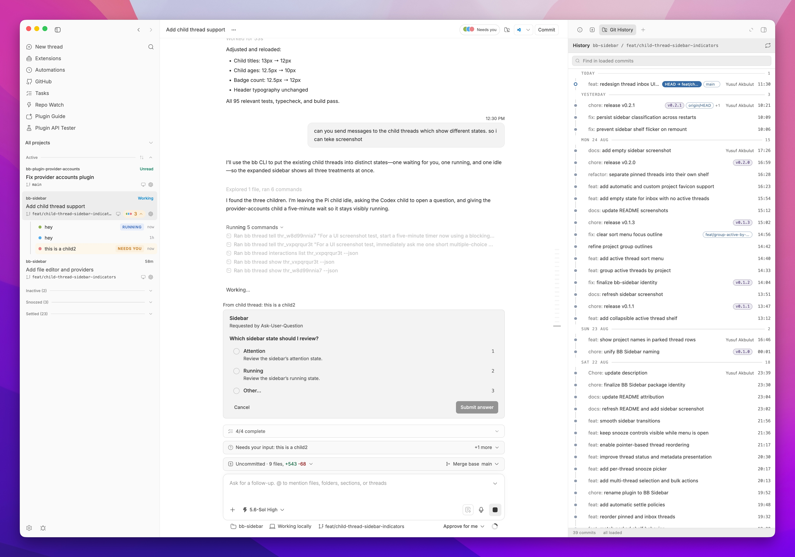
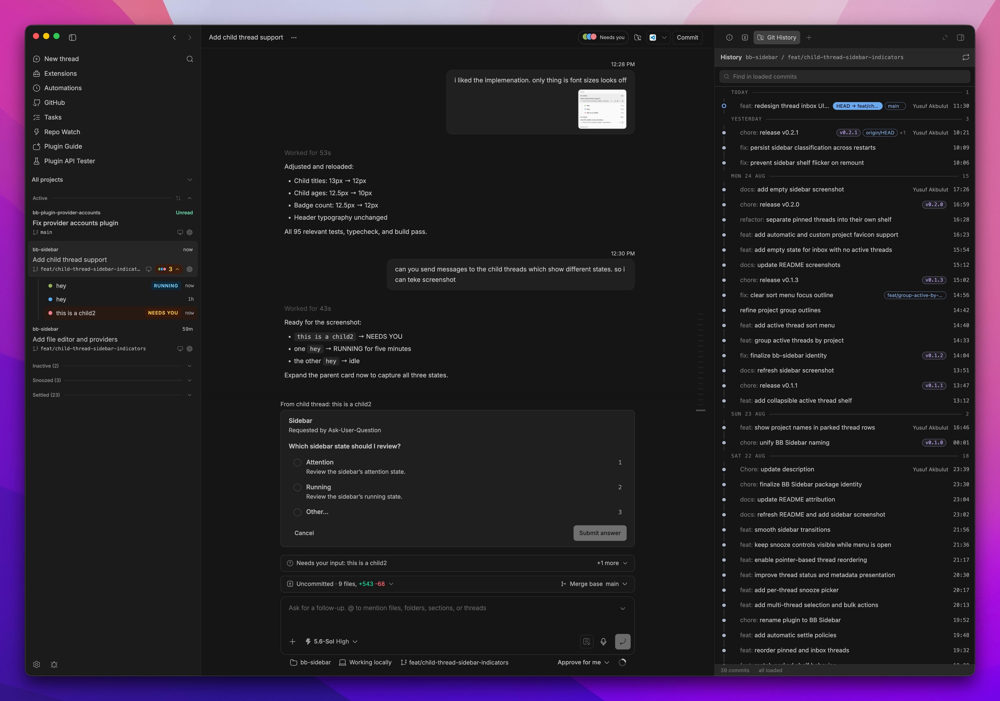
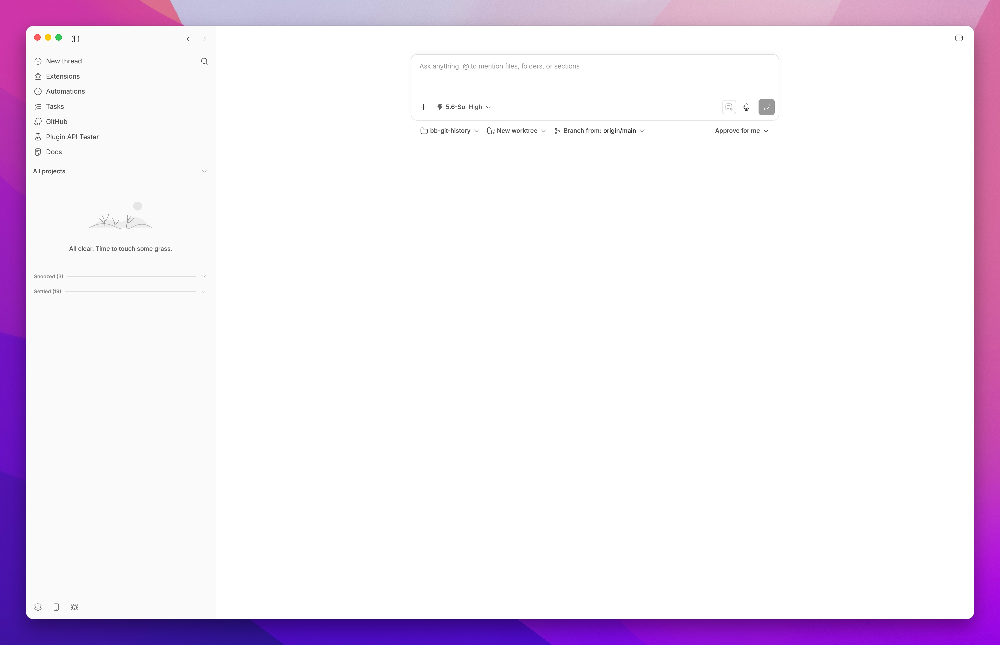

# SANDY Sidebar

A stable thread list for [sandy](https://github.com/nesyeklaf/sandy). Threads stay where you put them while status, snooze, and settle actions remain close at hand.







## Features

- Spaces: the default list groups sessions into the user's thread sections (Spaces), each a named cross-repo effort. Inside an open Space the sessions sit on status shelves (Needs you, Failed, Working, In review, Merged, Orchestrators, Dormant, Idle, Snoozed, and Archived when shown) rather than under repository groups; each row is the normal thread card, which still shows its repository and a pin marker for pinned sessions, and the header shows how many repositories the Space spans. Spaces start collapsed; the header shows counts for needs you, working, open PR and dormant (plus failed when non-zero) as filter chips. Dormant means an idle tree with no activity for seven complete days and a known absence of a PR; an unknown PR state is never dormant. Sessions inside every shelf of every Space follow a sort mode picked beside the Spaces heading (Manual order, Recent activity by default, Date created or Repo), saved separately from the Flow sort. Settings → Sidebar layout → Space headers picks Minimal, Compact (default) or Detailed. A saved Tree layout opens as Spaces; Flow stays available in the layout switch
- Manual ordering plus Recent activity, Date created, and Repo sort modes (Flow layout)
- Subtle repo grouping for repos with multiple active threads (Flow layout)
- Optional worktree grouping in Repo sort (Flow layout): threads that share a worktree get collapsible groups
- Shelves by status in the Flow layout: Pinned, Needs you, Failed, Working, In review, Idle, Dormant (idle for a week), Orchestrators, Merged, and Snoozed (parked threads included), plus settled and archived threads under View → Show archived
- Questions in the row: answer a single-choice question with one tap (Undo within five seconds), or Later to snooze it for an hour
- Row fields from View → Show on rows: diff +/−, PR number with its checks (✓ passed, ✕ failed, ● running), host, provider, subagents, age and last message, each one on or off. Last message starts off: it shows the thread's latest assistant text as one truncated line under the title on Comfortable and Compact rows, never on Dense ones. The plugin stores that text when a thread goes idle (the `thread.idle` event), so a thread shows a line after its next turn ends and nothing before
- Select mode from View → Select threads: tick rows, then Snooze, Archive, Pin, Tag or add a topic together from the bar at the bottom, each with Undo
- Session tags and topics: a row's ⋯ menu opens **Tags & Topics…** to edit the session's own tags and topics; on phone widths it opens as a bottom sheet. The tag and topic pickers above the list show two sections, **Session** (labels set on the session) and **In ranges** (labels of topic ranges inside it), each with counts; a label picked in one section matches only on that level
- Space coordination: several sessions of a Space can be orchestrators. An orchestrator may message, stop and archive only members the owner switched to Managed, and starts flat managed sessions with `space_start_session`. Ideas and a revisioned scratchpad belong to the Space; `sandy spaces` reaches all of it (see skills/sandy-sidebar-spaces). The old per-session idea and orchestrator marks were discarded. A fixed Space tab in the thread side panel (visible only for sessions in a Space) shows Overview (orchestrators, Managed switches, coordination settings, each member's latest report), Ideas and the Scratchpad editor; the row menu offers "Orchestrator of this Space" and "Managed", and a Space header button adds an orchestrator
- Activity bell beside the View button: the last 24 hours of asked, failed and finished threads, plus threads archived in that time with Restore; the badge counts questions waiting in Needs you
- On phone widths the search with its scope and tag/topic pickers sits at the bottom of the sidebar
- Density from the View button: Auto, Comfortable (three lines), Compact (two lines), or Dense (one line), with a per-shelf override in each shelf's ⋯ menu and options to keep pinned or woken threads full
- Searchable multi-repo filtering, remembered per window across reloads
- Optional repo colors with per-repo color selection. Names stay colored in every mode; show stripes in full and collapsed mode, full mode only, or grouped repos only
- Automatic repo icons with custom overrides
- Expandable child-thread indicators with running and attention states, on shelf rows too
- Live status, branch, pull request, and provider details, plus statuses set by other plugins
- Workspace port discovery, hover-card details, and optional browser links
- A Clean action in a settled row's ⋯ menu that previews and closes live terminals and verified thread-owned listening ports, while protecting Active and Working threads
- Configurable inactive-thread and automatic cleanup rules
- Native sandy navigation, split, rename, archive, and delete flows
- Repo submenu on thread cards for settings, rename, local paths, and removal
- Regenerate a thread title from its last three accepted user messages
- Automatically retry missing thread titles once in the background, respecting the selected AI title service and manual edits

Park threads while waiting on someone else. Use **Park thread** in the context menu and **Resume** when ready. Parked threads have no timer and are excluded from automatic cleanup. Opening one leaves it parked; new thread activity brings it back to Active.

Use **Parent** in a thread's context menu to search threads in the same repo, choose a parent, or select **None** to remove it. The current parent is checked; the thread itself and its descendants are excluded.

## CLI

The plugin adds the `sandy spaces` command tree for Space coordination: `show`, `orchestrator add|remove`, `member mode`, `settings`, `report`, `orphans`, `adopt`, `ideas list|add|update|remove` and `scratchpad show|write`. Each Space argument is an id or an exact name. A session that runs them may use only `show`, `ideas` and `scratchpad` for its own Space; changing orchestrators, member modes or coordination settings, and adopting orphans, is refused for sessions and stays with the owner. `report` is for managed members: it sends a short result to the Space's orchestrators. Run `sandy spaces --help` for flags.

Every other feature is reached through RPC methods, callable with `sandy plugin rpc call`, which validates the input against the plugin's schema on the server. The input is a JSON file:

```sh
echo '{"threadIds":["thr_abc123"],"topic":"Release"}' > /tmp/topic.json
sandy plugin rpc call sandy-sidebar-delegate addThreadTopic --input-file /tmp/topic.json
```

| Method | Input | Result |
| --- | --- | --- |
| `listAllTags` | `{}` | `{ threadTags, threadTopics, segments }`: session tags and topics per thread id, plus every topic range with its tags |
| `listTopics` | `{ threadId }` | `{ segments, threadTags, threadTopics }` of one session |
| `setTopicTags` | `{ kind: "thread" \| "segment", ownerId, tags }` | `{ tags }`, replacing the session's or the range's tags |
| `tagThreads` / `untagThreads` | `{ threadIds, tag }` | `{ tagged, atLimit }` / `{ untagged }` |
| `setThreadTopics` | `{ threadId, topics }` | `{ topics }`, replacing the session's topics |
| `addThreadTopic` / `removeThreadTopic` | `{ threadIds, topic }` | `{ added, atLimit }` / `{ removed }` |
| `getSpaceOverview` | `{ projectId? }` | `{ pullRequests, spaces }`: per Space total, counts (needs, failed, working, openPr, dormant), idle, repositories and representative roots with primary shelf. Listed by `sandy plugin rpc list`. `pullRequests` is `"available"` when GitHub PR Status answered for every environment, otherwise `"unavailable"`: open and merged PRs count, an absent PR makes a root dormant-eligible, and a draft, closed, offline or missing answer stays unknown and is never dormant |
| `getSpaceCoordination` | `{ spaceId }` | Members (status, project, environment, branch, PR, mode), orchestrators, coordination settings `{ selfReports, checkInMinutes, failureFallback }`, each member's latest report, ideas, scratchpad revision |
| `listOrchestrators` / `setOrchestrator` | `{}` / `{ threadId, orchestrator }` | `{ threadIds }` / `{ changed, spaceId }`; a Space may have several orchestrators |
| `setOrchestrators` | `{ threadIds, orchestrator }` | `{ changed }`; checks every session first and changes none when one is outside a Space |
| `setMemberMode` | `{ threadId, mode }` | `{ changed, mode }`; modes are independent (default) and managed |
| `setSpaceCoordinationSettings` | `{ spaceId, selfReports?, checkInMinutes?, failureFallback? }` | the full settings; `checkInMinutes` 0 to 1440, 0 turns check-ins off; owner only |
| `listIdeas` / `createIdea` / `updateIdea` / `deleteIdea` | per idea | Space ideas with status, author and linked sessions |
| `getScratchpad` / `writeScratchpad` | `{ spaceId }` / `{ spaceId, body, baseRevision }` | Revisioned Markdown; a stale write returns `{ status: "conflict", scratchpad }` |
| `listOrphanSpaces` / `adoptOrphanSpace` | `{}` / `{ oldSpaceId, spaceId }` | Ideas and scratchpads kept after a Space was deleted, and moving them into a live Space |

Tags are stored lowercase; topics keep their case. A session holds at most 20 tags and 20 topics; bulk calls report sessions at that limit in `atLimit`. Bulk calls take 1 to 500 thread ids. Only `getSpaceOverview` is listed by `sandy plugin rpc list`; the other methods are not registered as discoverable.

### Boundary

The Space protection is cooperative. It binds agents that use the Space tools and the normal `sandy` CLI, including sessions an orchestrator started. Restricted are orchestrators, sessions started with `space_start_session` and their descendants. Switching a started session to independent does not lift its own sender restriction. A session that clears `SANDY_THREAD_ID`, spoofs a sender, runs `sandy thread stop` or `archive`, creates a session without a parent through `sandy thread spawn`, or moves itself out of its Space and back through `sandy thread update --section` or `--clear-section` is not prevented, because the core takes caller identity from the client. A hard boundary needs an authenticated per-session identity for the CLI and HTTP plus a stop/archive hook. After a move the plugin has not observed, an orchestrator's tool list can be stale for one turn, and one dispatch can slip through a role change that lands mid-flight.

## Install

```sh
sandy plugin install git:https://github.com/yusuf8834/bb-sidebar.git
```

Requires sandy 0.47.0 or later. Pull request badges and automatic settling read pull request status from sandy's bundled GitHub PR Status plugin. While it is disabled, badges are hidden and threads with a workspace are not settled automatically.

Then choose **SANDY Sidebar** under **Settings > Appearance > Sidebar**.

## Development

```sh
npm install
npm run build
sandy plugin install path:. --yes
```

## Credits

See [THIRD_PARTY_NOTICES.md](THIRD_PARTY_NOTICES.md) for details.
