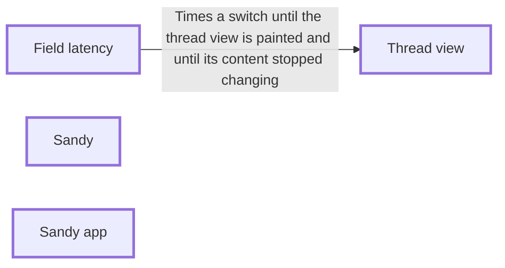

## Context

Owner target: a thread switch, first visit and revisit, is really done (field-latency contentDone) in a median of 100 ms. Field p50 revisit today: painted 204-536 ms, really done 715-1651 ms per device. Sandy has no holons for the parts this touches yet; this change set adds them and the requirement the first change must meet.

## Touched holons

Holons this change touches have a heavy outline; the arrows are their seams.

